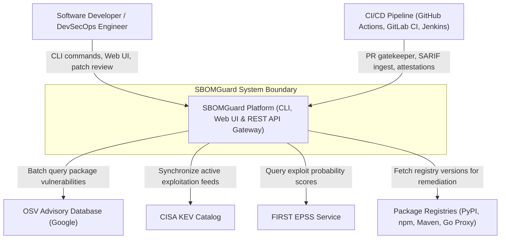
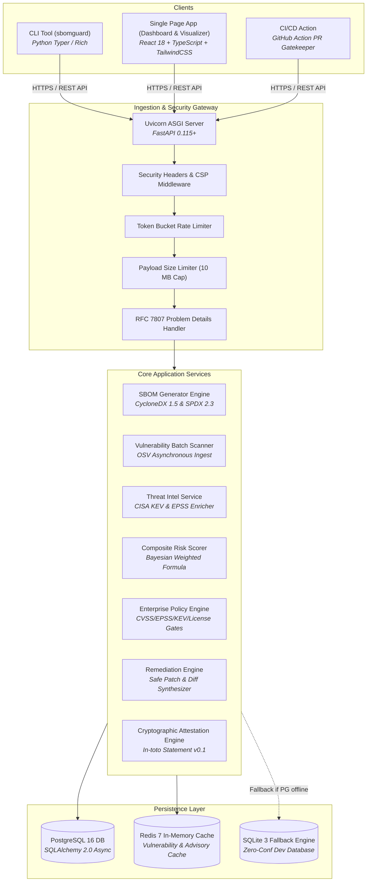
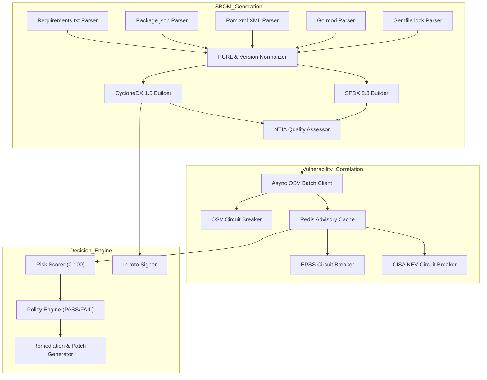
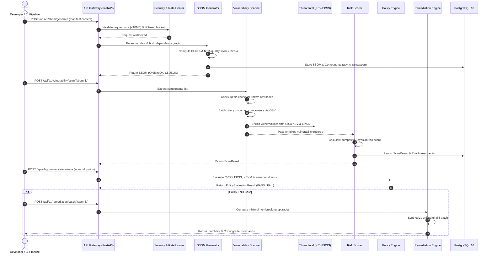
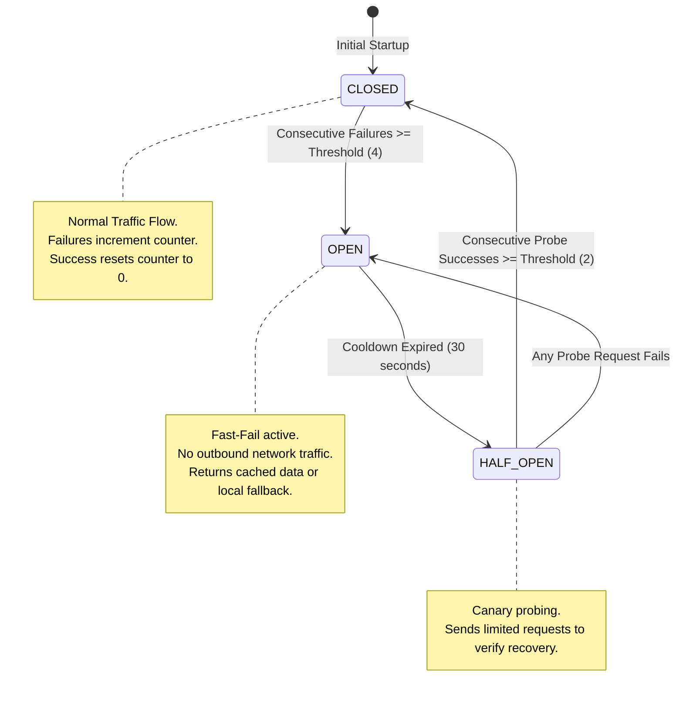
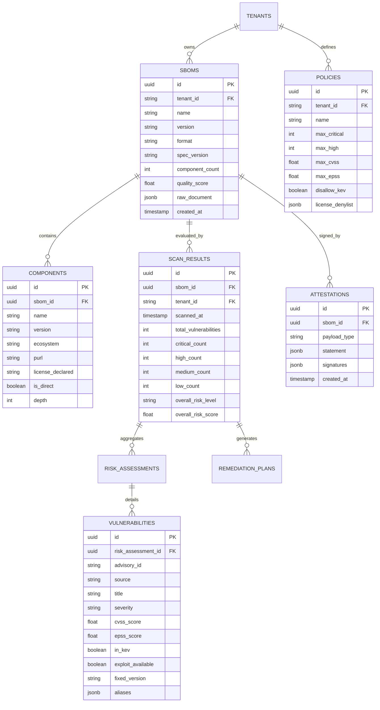

# 🏛️ SBOMGuard: Architectural Design & System Specification Document

> **Document Classification:** Production Architectural Specification (v2.0.0)  
> **Project:** SBOMGuard – Automated Framework for SBOM Generation, Vulnerability Analysis, and Supply Chain Risk Assessment  
> **Academic Degree:** Master of Computer Applications (MCA Major Project)  
> **Institution:** Chanakya University  
> **Author / Candidate:** MCA Major Project Candidate  
> **Date:** October 2026  

---

## 1. Architectural Vision & Design Principles

Modern software development relies heavily on third-party and open-source packages. Supply chain compromises (e.g., SolarWinds, Log4Shell, event-stream, XZ Utils) exploit lack of visibility into transitive dependencies. 

SBOMGuard is engineered to provide an **end-to-end, zero-trust software supply chain security framework** that combines:
1. **Automated Multi-Ecosystem Ingestion:** Polyglot dependency graph construction across PyPI, npm, Maven, and Go Modules.
2. **Dual-Standard SBOM Generation:** First-class compliance with CycloneDX 1.5 JSON and SPDX 2.3 specifications.
3. **Multi-Source Threat Intelligence:** OSV batch correlation enriched with CISA Known Exploited Vulnerabilities (KEV) and FIRST Exploit Prediction Scoring System (EPSS).
4. **Bayesian Risk Assessment:** Composite 0–100 risk scoring factoring CVSS severity, EPSS exploitability, active in-the-wild exploitation, dependency depth, and package criticality.
5. **Automated Remediation Engine:** Algorithmic resolution of minimal-breaking version upgrades with unified git diff patch generation.
6. **In-toto Cryptographic Attestation:** Software supply chain provenance signing and verification.
7. **Production Fault Tolerance:** Non-blocking asynchronous I/O, circuit breakers, RFC 7807 problem details, and multi-tenant isolation.

---

## 2. C4 Architectural Model

### Level 1: System Context Diagram

The System Context diagram describes SBOMGuard's role within the broader software delivery ecosystem.

---

### Level 2: Container Diagram

The Container diagram details the high-level technical runtime boundaries, storage systems, and communication protocols.

---

### Level 3: Component Diagram (Core Services)

---

## 3. Detailed Sequence Diagrams

### 3.1 End-to-End Analysis & Gatekeeping Flow

---

## 4. State Machine Specifications

### 4.1 Resilient Circuit Breaker State Machine

To protect SBOMGuard from cascading failures during third-party advisory outages (NVD, OSV, EPSS), all outbound HTTP clients are encapsulated in a 3-State Machine:

---

## 5. Relational Database Schema & Data Modeling

SBOMGuard v2.0 utilizes PostgreSQL 16 with asynchronous connection pooling (`asyncpg` and SQLAlchemy 2.0). If PostgreSQL is unavailable, an automated zero-downtime switch falls back to SQLite (`aiosqlite`).

---

## 6. Technology Selection Matrix & Rationale

| Layer | Selected Technology | Alternative Evaluated | Engineering Rationale |
| :--- | :--- | :--- | :--- |
| **Backend Framework** | **FastAPI 0.115+ (Python 3.12)** | Django REST Framework, Flask | Native `asyncio` concurrency for batch network I/O; automatic OpenAPI 3.1 documentation generation; Pydantic v2 data validation with C-speed parsing. |
| **Primary Database** | **PostgreSQL 16** | MongoDB, MySQL | Relational integrity for component graphs and audit logs; native JSONB indexing for CycloneDX/SPDX documents; transactional safety for multi-tenant isolation. |
| **ORM / Migration** | **SQLAlchemy 2.0 Async + Alembic** | Tortoise-ORM, Peewee | Industry-standard async ORM supporting enterprise DB switching, connection pooling, and declarative migrations. |
| **In-Memory Cache** | **Redis 7.2** | Memcached, In-Memory Dict | Atomic key expiration, shared cache across multi-worker Uvicorn processes, centralized token-bucket rate limiting. |
| **Frontend UI** | **React 18 + Vite + TailwindCSS** | Angular, Vue | Component reusability, lightning-fast HMR, rich ecosystem for graph visualizations (Recharts, Lucide), minimal production bundle size (<250 KB). |
| **CLI Framework** | **Typer + Rich** | Argparse, Click | Type-safe CLI definitions, automated shell completions, rich interactive ANSI terminal tables, and syntax-highlighted diffs. |
| **Container Runtime** | **Docker Multi-Stage (Alpine/Slim)** | Distroless | Multi-stage builder separates Node build from Python runtime, minimizing final image size to ~140 MB with unprivileged non-root execution (UID 10001). |

---

## 7. Security Architecture & Threat Boundaries

SBOMGuard adheres to the Principle of Least Privilege and Zero-Trust:
1. **Network Boundary:** The ingestion gateway enforces TLS 1.3, Content Security Policy (CSP), HSTS, and strict origin validation.
2. **Input Sanitization:** All uploaded manifest files are checked against content length headers and streamed through a bounded byte buffer to prevent Zip Bomb or ReDoS attacks.
3. **Database Security:** Parameterized queries via SQLAlchemy prevent SQL Injection. All queries filter by `tenant_id` to prevent Cross-Tenant Data Access (IDOR).
4. **Supply Chain Integrity:** Generated SBOMs can be cryptographically signed using the In-toto Attestation Engine with SHA-256 HMAC or ECDSA keys, establishing non-repudiation.
