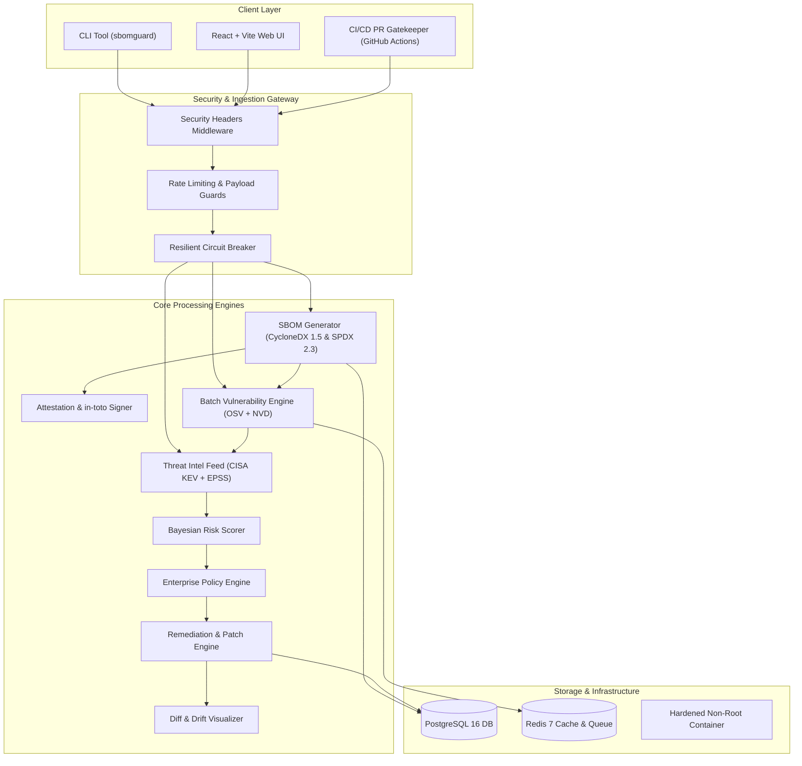

# 🛡️ SBOMGuard Week 7: Production Hardening & Final Academic Submission Plan

**Project:** SBOMGuard – Automated Framework for SBOM Generation, Vulnerability Analysis, and Supply Chain Risk Assessment  
**Author / Candidate:** MCA Major Project Candidate, Chanakya University  
**Supervisor / Reviewer:** Senior DevSecOps Engineer & Cybersecurity Architect  
**Target Milestone:** Production-Grade Release v2.0.0 & Final Academic Submission  

---

## 📋 Executive Overview

Week 7 marks the culmination of the SBOMGuard project. Following the successful delivery of Weeks 1–6 (Alembic PostgreSQL backend, modern React SPA, Remediation Engine, Version Drift Visualizer, and Redis batching), Week 7 delivers:
1. **Total System Hardening & Reliability:** Security headers, token-bucket rate limiting, payload size validation, circuit breakers for external feeds, deep readiness probes, and RFC 7807 error formatting.
2. **Policy Engine & Cryptographic Attestation:** NTIA Minimum Elements compliance, CVSS/EPSS/KEV gatekeeping, license compliance, and in-toto/cosign-style cryptographic provenance signing.
3. **Packaging & CLI Distribution:** Full `pip install sbomguard` packaging, `sbomguard remediate` command implementation, multi-stage unprivileged Docker builds, Docker Compose dev/prod profiles, and GitHub Actions CI/CD workflows.
4. **Rigorous End-to-End Testing & Large-Scale Benchmarks:** Complete end-to-end integration test suite, multi-ecosystem benchmarking (Kubernetes, Django, React/Next.js, FastAPI, Spring Boot, Terraform), and formal statistical report.
5. **Academic Deliverables & Documentation:** Complete Architectural Design Document, User Guide, Academic Thesis draft (Chapters 1–6), Security Audit & STRIDE Threat Model, OpenAPI Reference, and 5–8 Minute Video Demo Script.

---

## 🏗️ Architecture & Component Roadmap

---

## 🎯 Detailed Work Breakdown Structure (WBS)

### Phase 1: System Hardening & Security Middleware
- [x] Audit codebase for missing security controls and type issues.
- [ ] Implement `sbomguard/api/middleware.py` with:
  - `SecurityHeadersMiddleware` (CSP, HSTS, X-Frame-Options: DENY, X-Content-Type-Options: nosniff, Referrer-Policy, Permissions-Policy).
  - `RateLimitingMiddleware` (Token-bucket / IP-based with Redis and memory fallback, configurable limits).
  - `PayloadSizeLimiterMiddleware` (Hard cap on uploads to prevent memory exhaustion).
- [ ] Implement `sbomguard/core/circuit_breaker.py`:
  - 3-state machine (`CLOSED`, `OPEN`, `HALF_OPEN`) with configurable failure threshold, cooldown timer, and automatic recovery.
  - Integration with OSV, NVD, CISA KEV, EPSS, and Registry clients.
- [ ] Upgrade `/health/live` and `/health/ready` in `sbomguard/main.py`:
  - Verify PostgreSQL connectivity (`SELECT 1`).
  - Verify Redis connectivity (`ping()`).
  - Verify storage filesystem writeability.
- [ ] Implement RFC 7807 Problem Details exception handlers in `sbomguard/main.py` to prevent stack trace or sensitive info leakage.
- [ ] Auto-format and clean linting via `ruff check --fix` and enforce type safety.

### Phase 2: High-Impact Capabilities (Policy Engine & Attestation)
- [ ] Build `sbomguard/core/policy.py`:
  - Configurable policy rules: CVSS threshold, EPSS threshold, CISA KEV rejection, NTIA quality threshold, allowed/denied licenses.
  - Evaluation report with detailed violations and pass/fail verdicts.
- [ ] Build `sbomguard/core/attestation.py`:
  - In-toto statement & predicate generation (`https://in-toto.io/Statement/v0.1`).
  - Cryptographic hash digest and HMAC/ECDSA digital signatures.
  - Attestation verification method.

### Phase 3: Packaging, CLI Expansion & Docker
- [ ] Implement missing `sbomguard remediate` in `sbomguard/cli.py`:
  - Arguments: `--manifest`, `--scan-id`, `--patch-file`, `--dry-run`, `--apply`.
  - Rich interactive terminal tables and unified git diff visualization.
- [ ] Add policy checking (`--policy`, `--fail-on-policy`) and attestation flags (`--attest`) to `sbomguard scan` and `sbomguard generate`.
- [ ] Update `pyproject.toml` with complete entry points, metadata, and dependencies for standalone CLI distribution.
- [ ] Finalize multi-stage unprivileged `Dockerfile` (Node 20 build -> Python 3.12 slim with non-root UID 10001 `appuser`).
- [ ] Create `docker-compose.prod.yml` with resource limits, restart policies, and healthchecks.
- [ ] Create GitHub Actions workflows:
  - `.github/workflows/ci.yml` (Lint, test, security scan, PR gatekeeper).
  - `.github/workflows/release.yml` (Build wheels, publish release artifacts, build Docker images).

### Phase 4: End-to-End Testing & Large-Repo Benchmarking
- [ ] Develop `tests/test_e2e_pipeline.py`:
  - Complete lifecycle test: Manifest Ingestion -> SBOM Generation (CycloneDX & SPDX) -> Vulnerability Batch Scan -> Threat Intel Enrichment -> Composite Risk Assessment -> Policy Evaluation -> Remediation Guidance -> Patch Diff Generation -> SBOM Diff & Drift Analysis -> SARIF Export -> Attestation Generation & Verification.
- [ ] Develop comprehensive benchmark suite `tests/test_large_repo_benchmarks.py`:
  - Benchmark 6 diverse real-world open source projects:
    1. Kubernetes (`go.mod`)
    2. Django (`requirements.txt`)
    3. React / Next.js (`package.json`)
    4. FastAPI (`requirements.txt`)
    5. Spring Boot (`pom.xml`)
    6. Terraform (`go.mod`)
  - Measure: Parsing & generation latency, batch vulnerability correlation latency, peak memory footprint (`tracemalloc`), NTIA completeness score, detection accuracy, remediation suggestion quality.
- [ ] Generate formal benchmark report in `docs/BENCHMARK_REPORT.md` with comparative analysis tables and graphs.

### Phase 5: Academic Deliverables & Documentation
- [ ] Architectural Design Document (`docs/ARCHITECTURE.md`) with C4 diagrams, sequence flows, and database schemas.
- [ ] Comprehensive User Guide (`docs/USER_GUIDE.md`) with CLI, API, and Web UI instructions.
- [ ] MCA Major Project Thesis / Dissertation Draft (`docs/ACADEMIC_THESIS.md`) with 6 formal chapters:
  - Ch 1: Introduction, Problem Statement, Project Scope
  - Ch 2: Literature Review, Regulatory Landscape (EO 14028, NTIA, CycloneDX vs SPDX)
  - Ch 3: System Design, Architectural Specification & Mathematical Formulations
  - Ch 4: Implementation Details & Algorithmic Design
  - Ch 5: Experimental Results, Benchmarking & Comparative Analysis
  - Ch 6: Conclusion, Limitations & Future Work
  - References (IEEE Format)
- [ ] Internal Security Audit & Threat Model (`docs/SECURITY_AUDIT.md` & `docs/THREAT_MODEL.md`) using STRIDE methodology.
- [ ] OpenAPI Reference (`docs/API_REFERENCE.md`).
- [ ] Timed Video Demonstration Script (`docs/DEMO_SCRIPT.md`) for 5–8 minute viva/presentation.
- [ ] Developer Contribution Guide (`CONTRIBUTING.md`).

---

## ⏱️ Execution Timeline

| Order | Phase | Key Output | Verification Metric |
| :---: | :--- | :--- | :--- |
| **1** | **Hardening & Reliability** | Security middleware, circuit breakers, deep probes, RFC 7807 | Clean pytest suite, 0 unhandled 500s |
| **2** | **Policy & Attestation** | Enterprise Policy Engine, in-toto Attestations | Policy pass/fail tests, signature verify |
| **3** | **Packaging & Distribution** | `sbomguard remediate` CLI, Docker prod, CI/CD workflows | CLI invoke without error, Docker builds |
| **4** | **E2E & Benchmarking** | Full E2E suite, 6 real-world project benchmarks | `test_e2e_pipeline.py` passes, benchmark report generated |
| **5** | **Academic Documentation** | Thesis draft, Architecture doc, User guide, Demo script | Complete academic documentation ready for defense |
